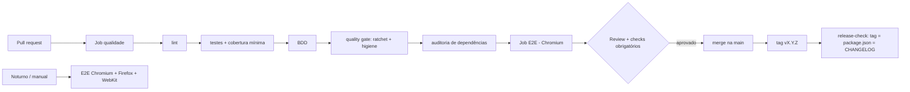

# Política de Quality Gates

> Regra de ouro: **um gate é uma decisão automática com critério escrito**. Se ninguém consegue dizer *por que* o número é aquele, o gate é decoração.

## Fluxo: do commit à release

Qualquer ✖ interrompe o fluxo naquele ponto. O job de E2E nem começa se o de qualidade falhou (`needs`).

## Os gates

| # | Gate | Onde | Critério | Por que este critério |
|---|---|---|---|---|
| 1 | Cobertura mínima | `coverageThreshold` do Jest, lido de `quality/politica.json` | stmts 90 · branches 80 · funcs 90 · lines 90 | Piso absoluto. Valores escolhidos a partir da cobertura real do projeto em 29/10 (98,1 · 83,5 · 100 · 98,7), com folga. |
| 2 | **Ratchet** | `quality/baseline.json` + `scripts/quality-gate.js` | cobertura **não pode cair** em relação ao último estado aprovado | O piso absoluto deixa o time "gastar" 8 pontos de folga sem ninguém ver. O ratchet só deixa subir. |
| 3 | Higiene de testes | `scripts/quality-gate.js` | zero `.only`, `.skip`, `xit`, `xdescribe` em `tests/`, `e2e/`, `features/` | `.only` isola um teste e esconde todos os outros; `.skip` apaga cobertura sem apagar o teste. |
| 4 | Dependências | `npm run audit:prod` | zero vulnerabilidade **alta** em dependências de **produção** | O que vai para o usuário importa mais que ferramenta de dev (hoje: 0 em produção; as 19 moderadas são todas de dev/Jest). |
| 5 | E2E | job `e2e` | todos os testes verdes; PR = Chromium; noturno = 3 navegadores | Custo × confiança: o navegador extra roda à noite, não em cada PR. |
| 6 | Release | `scripts/release-check.js` | tag = `package.json` = seção datada no `CHANGELOG.md` | Evita publicar "1.2.0" que na verdade contém outra coisa. |

## O que NÃO é gate aqui (de propósito)

- **Cobertura de 100%**: vira jogo de números. O ratchet já impede regressão.
- **Retry automático nos testes de unidade/API**: retry só no E2E (`retries: 1` em CI) e *com alerta*: teste que passou no retry aparece como **flaky** e deve virar tarefa.
- **Aprovação humana obrigatória**: é configuração do repositório (branch protection), não do código — ver seção abaixo.

## Como mudar a política

1. Altere `quality/politica.json` (fonte única: o Jest e o quality gate leem dele) **em um pull request**.
2. Explique o motivo no PR (o template pede).
3. Para **subir** o ratchet: `npm run quality:baseline` e commite `quality/baseline.json`. O script se recusa a **baixar** o baseline; baixar exige `--forcar` e justificativa no PR.

## Configuração do repositório (fora do código)

No GitHub: *Settings → Rules → Rulesets* (ou *Branches → Branch protection*) para a `main`:

- [ ] Exigir pull request antes do merge (≥ 1 aprovação)
- [ ] Exigir checks: **Qualidade (lint, testes, cobertura, gates)** e **E2E (chromium)**
- [ ] Exigir branch atualizada antes do merge
- [ ] Bloquear push direto na `main`

Sem isso, o CI vermelho **avisa** mas não **impede**. O gate só existe de verdade quando o merge depende dele.
